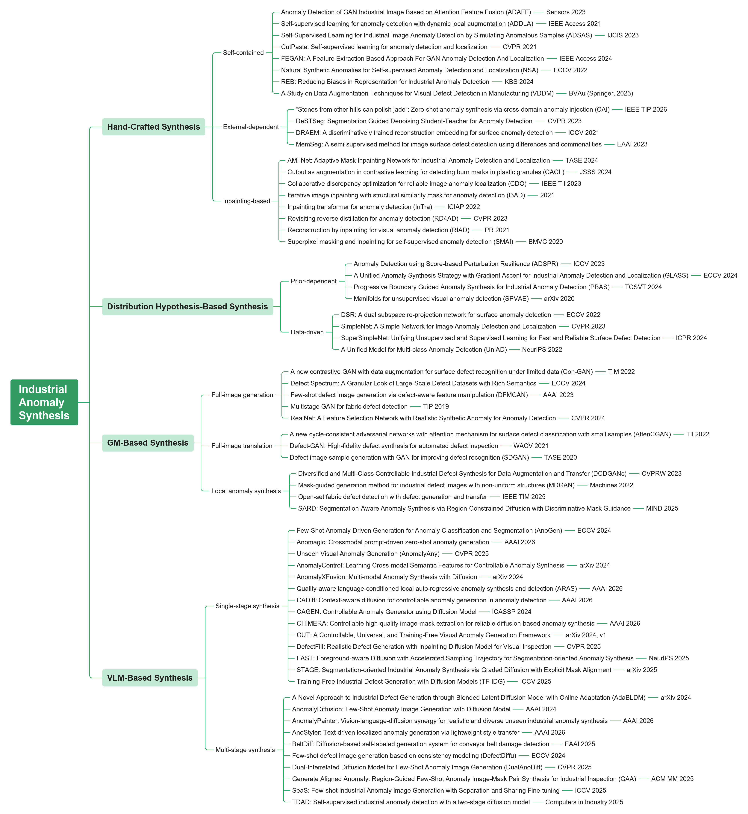

<h1 align="center">Awesome Industrial Anomaly Synthesis</h1>

<p align="center">
  A collection of papers and code on synthesizing industrial defects for visual inspection.<br>
  <em>Updated: 2026/11/24</em>
</p>

<p align="center">
  <strong><a href="https://openreview.net/forum?id=f9qjl5xCVW">A Survey on Industrial Anomaly Synthesis</a></strong><br>
  Yanshu Wang, Xichen Xu, Jinbao Wang, Chengbin Ma, Xiaoning Lei, Guoyang Xie, Guannan Jiang, and Zhichao Lu.<br>
  <em>Transactions on Machine Learning Research (TMLR), August 2026</em><br>
  <a href="https://openreview.net/forum?id=f9qjl5xCVW">TMLR / OpenReview</a> · <a href="https://openreview.net/pdf?id=f9qjl5xCVW">PDF</a> · <a href="#citation">BibTeX</a>
</p>

## Taxonomy

[](./paper_tree.png)

| Paradigm | How anomalies are synthesized |
| --- | --- |
| [Hand-crafted](#1-hand-crafted-synthesis) | Apply explicit image-editing rules, such as copying a patch, blending an external texture, or masking and inpainting. |
| [Distribution hypothesis-based](#2-distribution-hypothesis-based-synthesis) | Simulate departures from normal data, often in feature space rather than in pixels. |
| [Generative model (GM)-based](#3-gm-based-synthesis) | Train or adapt a generator to industrial imagery to generate a whole image, translate one, or edit a local region. |
| [Vision-language model (VLM)-based](#4-vlm-based-synthesis) | Adapt a pretrained multimodal model using prompts, reference images, or spatial conditions. |

Methods are grouped by the mechanism that produces the anomaly. For example, the use of a diffusion backbone alone does not determine whether a method is GM-based or VLM-based.

We welcome missing papers and corrections to the taxonomy. [Open an issue](https://github.com/M-3LAB/awesome-anomaly-synthesis/issues).

## Table of Contents

- [1. Hand-Crafted Synthesis](#1-hand-crafted-synthesis)
  - [1.1 Self-contained](#11-self-contained)
  - [1.2 External-dependent](#12-external-dependent)
  - [1.3 Inpainting-based](#13-inpainting-based)
- [2. Distribution Hypothesis-Based Synthesis](#2-distribution-hypothesis-based-synthesis)
  - [2.1 Prior-dependent](#21-prior-dependent)
  - [2.2 Data-driven](#22-data-driven)
- [3. GM-Based Synthesis](#3-gm-based-synthesis)
  - [3.1 Full-image generation](#31-full-image-generation)
  - [3.2 Full-image translation](#32-full-image-translation)
  - [3.3 Local anomaly synthesis](#33-local-anomaly-synthesis)
- [4. VLM-Based Synthesis](#4-vlm-based-synthesis)
  - [4.1 Single-stage synthesis](#41-single-stage-synthesis)
  - [4.2 Multi-stage synthesis](#42-multi-stage-synthesis)
- [Citation](#citation)

## 1. Hand-Crafted Synthesis

### 1.1 Self-contained

+ **[2021]** Self-supervised learning for anomaly detection with dynamic local augmentation (ADDLA) [[IEEE Access]](https://doi.org/10.1109/ACCESS.2021.3124525)
+ **[2021]** CutPaste: Self-supervised learning for anomaly detection and localization [[CVPR 2021]](https://arxiv.org/abs/2104.04015) [[unofficial code]](https://github.com/Runinho/pytorch-cutpaste)
+ **[2022]** Natural Synthetic Anomalies for Self-supervised Anomaly Detection and Localization (NSA) [[ECCV 2022]](https://arxiv.org/abs/2109.15222) [[code]](https://github.com/hmsch/natural-synthetic-anomalies)
+ **[2023]** Anomaly Detection of GAN Industrial Image Based on Attention Feature Fusion (ADAFF) [[Sensors]](https://www.mdpi.com/1424-8220/23/1/355)
+ **[2023]** Self-Supervised Learning for Industrial Image Anomaly Detection by Simulating Anomalous Samples (ADSAS) [[IJCIS]](https://link.springer.com/article/10.1007/s44196-023-00328-0)
+ **[2023]** A Study on Data Augmentation Techniques for Visual Defect Detection in Manufacturing (VDDM) [[BVAu (Springer)]](https://doi.org/10.1007/978-3-662-66769-9_6)
+ **[2024]** FEGAN: A Feature Extraction Based Approach For GAN Anomaly Detection And Localization [[IEEE Access]](https://ieeexplore.ieee.org/abstract/document/10540177/)
+ **[2024]** REB: Reducing Biases in Representation for Industrial Anomaly Detection [[KBS]](https://arxiv.org/abs/2308.12577) [[code]](https://github.com/ShuaiLYU/REB)

### 1.2 External-dependent

+ **[2021]** DRAEM: A discriminatively trained reconstruction embedding for surface anomaly detection [[ICCV 2021]](https://arxiv.org/abs/2108.07610) [[code]](https://github.com/vitjanz/draem)
+ **[2023]** DeSTSeg: Segmentation Guided Denoising Student-Teacher for Anomaly Detection [[CVPR 2023]](https://arxiv.org/abs/2211.11317) [[code]](https://github.com/apple/ml-destseg)
+ **[2023]** MemSeg: A semi-supervised method for image surface defect detection using differences and commonalities [[EAAI]](https://arxiv.org/abs/2205.00908) [[unofficial code]](https://github.com/TooTouch/MemSeg)
+ **[2026]** “Stones from other hills can polish jade”: Zero-shot anomaly synthesis via cross-domain anomaly injection (CAI) [[IEEE TIP]](https://doi.org/10.1109/TIP.2026.3675432)

### 1.3 Inpainting-based

+ **[2020]** Superpixel masking and inpainting for self-supervised anomaly detection (SMAI) [[BMVC 2020]](https://www.bmvc2020-conference.com/assets/papers/0275.pdf)
+ **[2021]** Iterative image inpainting with structural similarity mask for anomaly detection (I3AD) [[paper]](https://openreview.net/forum?id=b4ach0lGuYO)
+ **[2021]** Reconstruction by inpainting for visual anomaly detection (RIAD) [[PR]](https://www.sciencedirect.com/science/article/pii/S0031320320305094) [[unofficial code]](https://github.com/taikiinoue45/RIAD)
+ **[2022]** Inpainting transformer for anomaly detection (InTra) [[ICIAP 2022]](https://arxiv.org/abs/2104.13897) [[unofficial code]](https://github.com/jhy12/inpainting-transformer)
+ **[2023]** Collaborative discrepancy optimization for reliable image anomaly localization (CDO) [[IEEE TII]](https://arxiv.org/abs/2302.08769) [[code]](https://github.com/caoyunkang/CDO)
+ **[2023]** Revisiting reverse distillation for anomaly detection (RD4AD) [[CVPR 2023]](https://openaccess.thecvf.com/content/CVPR2023/html/Tien_Revisiting_Reverse_Distillation_for_Anomaly_Detection_CVPR_2023_paper.html) [[code]](https://github.com/tientrandinh/Revisiting-Reverse-Distillation)
+ **[2024]** AMI-Net: Adaptive Mask Inpainting Network for Industrial Anomaly Detection and Localization [[TASE]](https://ieeexplore.ieee.org/abstract/document/10445116) [[code]](https://github.com/luow23/AMI-Net)
+ **[2024]** Cutout as augmentation in contrastive learning for detecting burn marks in plastic granules (CACL) [[JSSS]](https://jsss.copernicus.org/articles/13/63/2024/)

## 2. Distribution Hypothesis-Based Synthesis

### 2.1 Prior-dependent

+ **[2020]** Manifolds for unsupervised visual anomaly detection (SPVAE) [[arXiv]](https://arxiv.org/abs/2006.11364)
+ **[2023]** Anomaly Detection using Score-based Perturbation Resilience (ADSPR) [[ICCV 2023]](https://openaccess.thecvf.com/content/ICCV2023/papers/Shin_Anomaly_Detection_using_Score-based_Perturbation_Resilience_ICCV_2023_paper.pdf) [[code]](https://github.com/Lee-JongHyeon/Anomaly-Detection-using-Score-based-Perturbation-Resilience)
+ **[2024]** A Unified Anomaly Synthesis Strategy with Gradient Ascent for Industrial Anomaly Detection and Localization (GLASS) [[ECCV 2024]](https://arxiv.org/abs/2407.09359) [[code]](https://github.com/cqylunlun/GLASS)
+ **[2024]** Progressive Boundary Guided Anomaly Synthesis for Industrial Anomaly Detection (PBAS) [[TCSVT]](https://ieeexplore.ieee.org/document/10716437) [[code]](https://github.com/cqylunlun/PBAS)

### 2.2 Data-driven

+ **[2022]** DSR: A dual subspace re-projection network for surface anomaly detection [[ECCV 2022]](https://arxiv.org/abs/2208.01521) [[code]](https://github.com/VitjanZ/DSR_anomaly_detection)
+ **[2022]** A Unified Model for Multi-class Anomaly Detection (UniAD) [[NeurIPS 2022]](https://arxiv.org/abs/2206.03687) [[code]](https://github.com/zhiyuanyou/UniAD)
+ **[2023]** SimpleNet: A Simple Network for Image Anomaly Detection and Localization [[CVPR 2023]](https://arxiv.org/abs/2303.15140) [[code]](https://github.com/DonaldRR/SimpleNet)
+ **[2024]** SuperSimpleNet: Unifying Unsupervised and Supervised Learning for Fast and Reliable Surface Defect Detection [[ICPR 2024]](https://arxiv.org/abs/2408.03143) [[code]](https://github.com/blaz-r/SuperSimpleNet/tree/main)
+ **[2024]** GLAD: Towards Better Reconstruction with Global and Local Adaptive Diffusion Models for Unsupervised Anomaly Detection [[ECCV 2024]](https://arxiv.org/abs/2406.07487) [[code]](https://github.com/hyao1/GLAD)
+ **[2024]** GeneralAD: Anomaly Detection Across Domains by Attending to Distorted Features [[ECCV 2024]](https://arxiv.org/abs/2407.12427) [[code]](https://github.com/LucStrater/GeneralAD)

## 3. GM-Based Synthesis

### 3.1 Full-image generation

+ **[2019]** Multistage GAN for fabric defect detection [[TIP]](https://pubmed.ncbi.nlm.nih.gov/31870985/)
+ **[2022]** A new contrastive GAN with data augmentation for surface defect recognition under limited data (Con-GAN) [[TIM]](https://ieeexplore.ieee.org/abstract/document/9999697/)
+ **[2023]** Few-shot defect image generation via defect-aware feature manipulation (DFMGAN) [[AAAI 2023]](https://arxiv.org/abs/2303.02389) [[code]](https://github.com/Ldhlwh/DFMGAN)
+ **[2024]** Defect Spectrum: A Granular Look of Large-Scale Defect Datasets with Rich Semantics [[ECCV 2024]](https://openreview.net/forum?id=RLhS1TrjK3) [[code]](https://github.com/EnVision-Research/Defect_Spectrum) [[data / project]](https://github.com/EnVision-Research/Defect_Spectrum#readme)
+ **[2024]** RealNet: A Feature Selection Network with Realistic Synthetic Anomaly for Anomaly Detection [[CVPR 2024]](https://arxiv.org/abs/2403.05897) [[code]](https://github.com/cnulab/RealNet)

### 3.2 Full-image translation

+ **[2020]** Defect image sample generation with GAN for improving defect recognition (SDGAN) [[TASE]](https://ieeexplore.ieee.org/stamp/stamp.jsp?tp=&arnumber=9000806)
+ **[2021]** Defect-GAN: High-fidelity defect synthesis for automated defect inspection [[WACV 2021]](https://openaccess.thecvf.com/content/WACV2021/papers/Zhang_Defect-GAN_High-Fidelity_Defect_Synthesis_for_Automated_Defect_Inspection_WACV_2021_paper.pdf) [[unofficial code]](https://github.com/TimZhang001/Defect_GAN-PyTorch)
+ **[2022]** A new cycle-consistent adversarial networks with attention mechanism for surface defect classification with small samples (AttenCGAN) [[TII]](https://ieeexplore.ieee.org/abstract/document/9760037/)

### 3.3 Local anomaly synthesis

+ **[2022]** Mask-guided generation method for industrial defect images with non-uniform structures (MDGAN) [[Machines]](https://www.mdpi.com/2075-1702/10/12/1239) [[unofficial code]](https://github.com/hits-gold/MDGAN-pytorch)
+ **[2023]** Diversified and Multi-Class Controllable Industrial Defect Synthesis for Data Augmentation and Transfer (DCDGANc) [[CVPRW 2023]](https://openaccess.thecvf.com/content/CVPR2023W/VISION/html/Wei_Diversified_and_Multi-Class_Controllable_Industrial_Defect_Synthesis_for_Data_Augmentation_CVPRW_2023_paper.html)
+ **[2025]** Open-set fabric defect detection with defect generation and transfer [[IEEE TIM]](https://doi.org/10.1109/TIM.2025.3547485)
+ **[2025]** SARD: Segmentation-Aware Anomaly Synthesis via Region-Constrained Diffusion with Discriminative Mask Guidance [[MIND 2025]](https://doi.org/10.1109/MIND67540.2025.11351901)
+ **[2025]** Structured guided diffusion models for industrial defect image generation (Structured-GDM) [[KBS]](https://doi.org/10.1016/j.knosys.2025.114642) [[code]](https://github.com/xieyulai/Structured-DGM) (inference demo only)

## 4. VLM-Based Synthesis

### 4.1 Single-stage synthesis

+ **[2024]** Few-Shot Anomaly-Driven Generation for Anomaly Classification and Segmentation (AnoGen) [[ECCV 2024]](https://csgaobb.github.io/Pub_files/ECCV2024_AnoGen_CR_0730_Mobile.pdf) [[code]](https://github.com/gaobb/AnoGen)
+ **[2024]** AnomalyControl: Learning Cross-modal Semantic Features for Controllable Anomaly Synthesis [[arXiv]](https://arxiv.org/abs/2412.06510) [[code]](https://github.com/DaniellaHe/AnomalyControl)
+ **[2024]** AnomalyXFusion: Multi-modal Anomaly Synthesis with Diffusion [[arXiv]](https://arxiv.org/abs/2404.19444) [[code]](https://github.com/hujiecpp/MVTec-Caption) (model components and dataset tools)
+ **[2024]** CAGEN: Controllable Anomaly Generator using Diffusion Model [[ICASSP 2024]](https://ieeexplore.ieee.org/document/10447663)
+ **[2024]** CUT: A Controllable, Universal, and Training-Free Visual Anomaly Generation Framework [[arXiv v1]](https://arxiv.org/abs/2406.01078v1)
+ **[2025]** Unseen Visual Anomaly Generation (AnomalyAny) [[CVPR 2025]](https://openaccess.thecvf.com/content/CVPR2025/papers/Sun_Unseen_Visual_Anomaly_Generation_CVPR_2025_paper.pdf) [[code]](https://github.com/EPFL-IMOS/AnomalyAny)
+ **[2025]** DefectFill: Realistic Defect Generation with Inpainting Diffusion Model for Visual Inspection [[CVPR 2025]](https://openaccess.thecvf.com/content/CVPR2025/html/Song_DefectFill_Realistic_Defect_Generation_with_Inpainting_Diffusion_Model_for_Visual_CVPR_2025_paper.html) [[unofficial code]](https://github.com/axelsig1/DefectFill)
+ **[2025]** FAST: Foreground-aware Diffusion with Accelerated Sampling Trajectory for Segmentation-oriented Anomaly Synthesis [[NeurIPS 2025]](https://openreview.net/forum?id=qqEfm8tlCM) [[code]](https://github.com/Chhro123/fast-foreground-aware-anomaly-synthesis)
+ **[2025]** STAGE: Segmentation-oriented Industrial Anomaly Synthesis via Graded Diffusion with Explicit Mask Alignment [[arXiv]](https://arxiv.org/abs/2509.06693) [[code]](https://github.com/Chhro123/STAGE)
+ **[2025]** Training-Free Industrial Defect Generation with Diffusion Models (TF-IDG) [[ICCV 2025]](https://openaccess.thecvf.com/content/ICCV2025/html/Xu_Training-Free_Industrial_Defect_Generation_with_Diffusion_Models_ICCV_2025_paper.html) [[code]](https://github.com/rubymiaomiao/TF-IDG)
+ **[2026]** Anomagic: Crossmodal prompt-driven zero-shot anomaly generation [[AAAI 2026]](https://ojs.aaai.org/index.php/AAAI/article/view/37466) [[code]](https://github.com/yuxin-jiang/Anomagic)
+ **[2026]** Quality-aware language-conditioned local auto-regressive anomaly synthesis and detection (ARAS) [[AAAI 2026]](https://ojs.aaai.org/index.php/AAAI/article/view/38592) [[code]](https://github.com/CASIA-LMC-Lab/QARAD)
+ **[2026]** CADiff: Context-aware diffusion for controllable anomaly generation in anomaly detection [[AAAI 2026]](https://ojs.aaai.org/index.php/AAAI/article/view/37917)
+ **[2026]** CHIMERA: Controllable high-quality image-mask extraction for reliable diffusion-based anomaly synthesis [[AAAI 2026]](https://ojs.aaai.org/index.php/AAAI/article/view/37511)

CUT links to the original preprint (v1); AnomalyAny links to the later CVPR paper. The survey lists both labels.

### 4.2 Multi-stage synthesis

+ **[2024]** A Novel Approach to Industrial Defect Generation through Blended Latent Diffusion Model with Online Adaptation (AdaBLDM) [[arXiv]](https://arxiv.org/abs/2402.19330) [[code]](https://github.com/GrandpaXun242/AdaBLDM)
+ **[2024]** AnomalyDiffusion: Few-Shot Anomaly Image Generation with Diffusion Model [[AAAI 2024]](https://ojs.aaai.org/index.php/AAAI/article/view/28696) [[code]](https://github.com/sjtuplayer/anomalydiffusion)
+ **[2024]** Few-shot defect image generation based on consistency modeling (DefectDiffu) [[ECCV 2024]](https://link.springer.com/chapter/10.1007/978-3-031-73116-7_21) [[code]](https://github.com/FFDD-diffusion/DefectDiffu)
+ **[2025]** BeltDiff: Diffusion-based self-labeled generation system for conveyor belt damage detection [[EAAI]](https://www.sciencedirect.com/science/article/pii/S095219762502295X)
+ **[2025]** Dual-Interrelated Diffusion Model for Few-Shot Anomaly Image Generation (DualAnoDiff) [[CVPR 2025]](https://arxiv.org/abs/2408.13509) [[code]](https://github.com/yinyjin/DualAnoDiff)
+ **[2025]** Generate Aligned Anomaly: Region-Guided Few-Shot Anomaly Image-Mask Pair Synthesis for Industrial Inspection (GAA) [[ACM MM 2025]](https://arxiv.org/abs/2507.09619)
+ **[2025]** SeaS: Few-shot Industrial Anomaly Image Generation with Separation and Sharing Fine-tuning [[ICCV 2025]](https://arxiv.org/abs/2410.14987) [[code]](https://github.com/HUST-SLOW/SeaS)
+ **[2025]** TDAD: Self-supervised industrial anomaly detection with a two-stage diffusion model [[Computers in Industry]](https://www.sciencedirect.com/science/article/pii/S0166361524001209)
+ **[2026]** AnomalyPainter: Vision-language-diffusion synergy for realistic and diverse unseen industrial anomaly synthesis [[AAAI 2026]](https://ojs.aaai.org/index.php/AAAI/article/view/37501)
+ **[2026]** AnoStyler: Text-driven localized anomaly generation via lightweight style transfer [[AAAI 2026]](https://ojs.aaai.org/index.php/AAAI/article/view/38604) [[code]](https://github.com/yulimso/AnoStyler)

## Citation

If you find this survey useful in your research, please consider citing it:

```bibtex
@article{wang2026industrialanomalysynthesis,
  title   = {A Survey on Industrial Anomaly Synthesis},
  author  = {Wang, Yanshu and Xu, Xichen and Wang, Jinbao and Ma, Chengbin and Lei, Xiaoning and Xie, Guoyang and Jiang, Guannan and Lu, Zhichao},
  journal = {Transactions on Machine Learning Research},
  year    = {2026},
  url     = {https://openreview.net/forum?id=f9qjl5xCVW}
}
```
